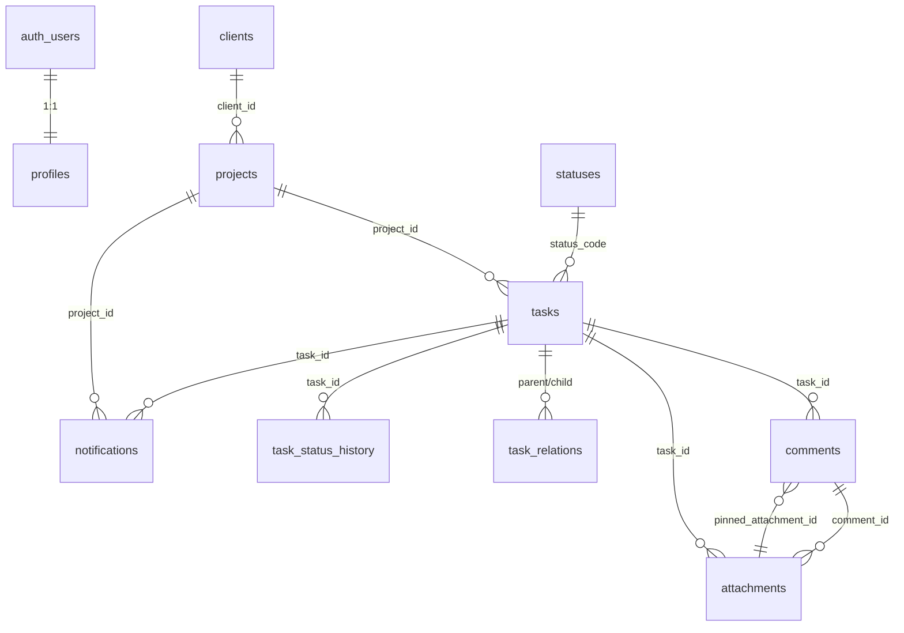

# Neyroflow

Трекер задач для небольшой студии: админ ведёт канбан, клиент согласует
работы в отдельном портале, правки ставятся пинами прямо на макетах.
Публичное демо работает без входа.

> **Внимание: система использует зарубежные сервисы хранения данных. Запрещено
> загружать реальные персональные данные (ПДн). Используйте только маскированные
> или тестовые данные.**

## Возможности

- **Канбан** с шестью статусами и drag-and-drop; клавиатурный перенос
  (`Space` → стрелки → `Space`).
- **Задачи:** создание, редактирование, удаление, приоритет, дедлайн,
  parent/child-связи с защитой от циклов.
- **Файлы:** JPEG, PNG, WebP, PDF до 500 КБ; ZIP и DOCX до 2 МБ; до 4 файлов
  на задачу и на комментарий; magic bytes + MIME + размер; приватный Storage и
  signed URL на 1 час; SVG/GIF отклоняются.
- **Пины на изображениях:** клик/тап → комментарий в точке; координаты в
  процентах, поэтому маркеры не съезжают при ресайзе и на мобильном.
- **Клиентский портал:** свои проекты, доска, задача, файлы, комментарии,
  история статусов. Клиент может ответить, принять работу или отправить на
  доработку.
- **Уведомления:** комментарий, файл, смена статуса, дедлайн за 24 часа;
  колокольчик, polling 30 секунд, «прочитать все».
- **Публичное демо** `/demo`: вымышленные проекты и задачи, только чтение.
- **Аудит** действий админа и клиента; append-only.
- Светлая/тёмная темы, адаптив от 360 px, CSS-3D hero без WebGL.

## Стек

- Next.js 16 (App Router, `proxy.ts`), React 19, TypeScript strict.
- Tailwind CSS 4, shadcn/ui (`base-nova`), lucide-react, framer-motion.
- Supabase: Postgres, Auth, приватный Storage, RLS.
- `@dnd-kit` для канбана, `@supabase/ssr` для админской сессии.
- Vitest для чистой логики; dsh-pilot для ручного UI QA.

## Роли и безопасность

- **Один владелец** на инсталляцию. Публичной регистрации нет.
- **Админ** входит через Supabase Auth; `/admin` защищён `proxy.ts` и
  повторной проверкой в layout. Чтения и CRUD идут через RLS.
- **Клиент** входит по инвайт-ссылке; в БД хранится только SHA-256 токена,
  cookie `client_session` — JWT HS256, HttpOnly, SameSite=Lax, Secure в проде.
  `session_version` проверяется на каждом запросе; перевыпуск/отзыв инвайта
  убивает старые сессии.
- **Клиентский портал и демо** используют `service_role` только на сервере;
  каждый запрос фильтруется по `client_id` / `is_demo = true`.
- **RLS** включён на всех таблицах; `anon` не имеет доступа; аудит — только
  select/insert.
- **CSRF/rate limit:** origin-check на route handlers, лимиты на login,
  `/invite` и `/api/attachments`.
- Security headers: `X-Content-Type-Options`, `Referrer-Policy`,
  `X-Frame-Options: DENY`, `Permissions-Policy`.
- `.env.local` не читается агентом и не коммитится; в репозитории только
  `.env.example` без значений.

## Быстрый старт

```bash
cp .env.example .env.local
npm_config_cache=.npm-cache npm install --ignore-scripts --no-audit --no-fund
npm run dev
```

Открыть `http://localhost:3000`.

### Переменные окружения

| Переменная | Где используется |
|---|---|
| `NEXT_PUBLIC_SUPABASE_URL` | Project URL Supabase, **без** `/rest/v1/` |
| `NEXT_PUBLIC_SUPABASE_ANON_KEY` | публичный ключ Supabase |
| `SUPABASE_SERVICE_ROLE_KEY` | только сервер: Storage, клиентский портал, демо, cron |
| `CLIENT_SESSION_SECRET` | подпись `client_session` (HS256) |
| `NEXT_PUBLIC_SITE_URL` | `http://localhost:3000` локально, `https://neyrocontent.ru` в проде |
| `CRON_SECRET` | Bearer-токен для `/api/cron/deadlines` |

Секреты `CLIENT_SESSION_SECRET` и `CRON_SECRET` генерируются владельцем:

```bash
openssl rand -base64 32
```

Никогда не коммитьте `.env.local` и не отправляйте значения в чат.

### Supabase

1. Создать проект Supabase.
2. SQL Editor → выполнить `supabase/migrations/0001_init.sql`.
3. Для production — `supabase/seed.sql` (6 статусов + демо-данные).
4. Authentication → Providers → Email: включить, отключить публичную
   регистрацию.
5. Authentication → Users → Add user: создать админа.
6. Project Settings → API: взять Project URL, `anon`, `service_role`.
7. Storage: bucket `attachments` создаётся миграцией, приватный.
8. Заполнить `.env.local` / Vercel env.

Подробнее: [docs/SUPABASE-SETUP.md](docs/SUPABASE-SETUP.md).

### Dev-инвайты

Только для локальной разработки, после `supabase/seed.dev.sql`:

- клиент A: `/invite?token=dev-client-a-token`
- клиент B: `/invite?token=dev-client-b-token`

Это публичные тестовые значения, не production-секреты. Удалить:
`supabase/cleanup.dev.sql`.

## Схема БД



Полная схема, порядок применения и проверки: [docs/SCHEMA.md](docs/SCHEMA.md).

## Деплой на Vercel

1. Запушить репозиторий на GitHub.
2. Vercel → **Add New → Project** → импортировать репозиторий.
   Framework Preset: **Next.js**; Node.js 22.x.
3. **Settings → Environment Variables** — добавить все шесть переменных из
   `.env.example` с production-значениями. Для `NEXT_PUBLIC_SITE_URL`:
   `https://neyrocontent.ru`.
4. Deploy. `vercel.json` включает cron `/api/cron/deadlines` по расписанию
   `0 6 * * *` UTC = **09:00 МСК**. В Vercel должен быть задан `CRON_SECRET`;
   Vercel отправляет его как `Authorization: Bearer <CRON_SECRET>`.
5. Supabase → Authentication → URL Configuration: добавить
   `https://neyrocontent.ru` в Site URL / Redirect URLs.
6. Проверить `/api/health`, `/demo`, вход админа и инвайт клиента.

### Домен `neyrocontent.ru` (Reg.ru)

1. Vercel → Project → **Settings → Domains → Add** → `neyrocontent.ru` и
   `www.neyrocontent.ru`.
2. Vercel покажет точные DNS-значения. Для apex обычно:

   | Тип | Имя | Значение |
   |---|---|---|
   | A | `@` | `76.76.21.21` |
   | CNAME | `www` | `cname.vercel-dns.com` |

   **Берите значения из Vercel** — они могут отличаться.
3. В Reg.ru → Домены → DNS-серверы и зоны: добавить записи, удалить
   конфликтующие A/CNAME, TTL 3600.
4. Дождаться проверки в Vercel (до 24–48 часов).
5. Fallback-адрес: `https://neyrocontent.vercel.app`.

Подробнее: [docs/DEPLOY.md](docs/DEPLOY.md).

## Проверки

```bash
npm run lint
npm run typecheck
npm run test
npm run check:secrets
npm run verify
npm run verify:build
```

`npm run verify:build` собирает проект в чистой копии с фиктивными public-env
и без `.env.local`.

## Структура

```
app/
  admin/            админка, канбан, задачи, клиенты
  client/           клиентский портал
  demo/             публичное демо (read-only)
  api/              attachments, notifications, health, cron
  comments/         server actions комментариев и клиентских статусов
components/
  landing/          hero, CSS-3D, фичи, CTA
  task-comments.tsx пины и комментарии
docs/               TS, решения, дизайн, схема, Supabase, деплой
lib/                auth, repositories, files, pins, status, audit
supabase/           миграция, seed, dev seed, cleanup, reset
```

## Ограничения MVP

- Один владелец на инсталляцию; клиенты не создают аккаунты.
- Rate limit in-memory — на инстанс; для MVP достаточно.
- Cron на Vercel зависит от тарифа; проверить, что daily cron доступен.
- Демо-данные вымышлены; реальные ПДн запрещены.
- Полный Playwright-набор не входит в MVP; UI проверяется dsh-pilot.

## Референс и скриншоты

- `reference.jpg` / `docs/reference.jpg` — настроение, не буквальное
  копирование. CSS-3D hero без WebGL и внешних 3D-ассетов.
- Скриншоты: [docs/screenshots](docs/screenshots).

## Лицензия

Учебный/портфолио-проект. Перед коммерческим использованием проверьте лицензии
зависимостей и ассетов.
