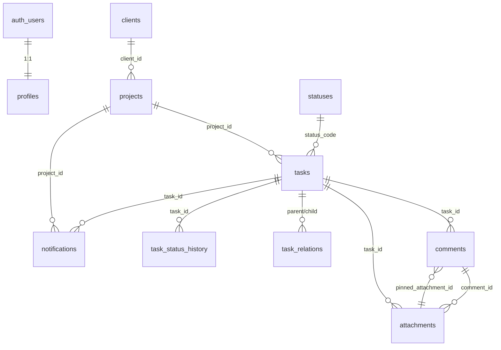

# Схема данных — Neyroflow

**Файлы:** `supabase/migrations/0001_init.sql`, `supabase/seed.sql`,
`supabase/seed.dev.sql`, `supabase/cleanup.dev.sql`, `supabase/reset.sql`.

## Порядок применения

1. `0001_init.sql` — таблицы, индексы, триггеры, RLS, bucket.
2. `seed.sql` — 6 статусов + демо-клиент, 2 проекта, 12 задач, пины.
3. `seed.dev.sql` — только для разработки: 2 тестовых клиента с известными
   инвайтами.
4. `cleanup.dev.sql` — удалить dev-данные.
5. `reset.sql` — **destructive**, только локально/на стейджинге.

Все файлы обёрнуты в `begin/commit`: при ошибке ничего не применяется
частично. Повторный запуск миграции идемпотентен для объектов; для чистого
пересоздания используйте `reset.sql`, затем снова миграцию.

## ER-диаграмма



`auth_users` — таблица Supabase Auth; `profiles` создаётся триггером при
создании пользователя.

## Ключевые правила

- **Статусы** — фиксированный справочник из 6 строк, `sort_order` уникален.
- **Позиция задачи** — `numeric`, сортировка внутри колонки.
- **Связи** — один родитель, много детей; триггер запрещает циклы.
- **Вложения** — XOR `task_id`/`comment_id`; максимум 4 на задачу и 4 на
  комментарий; bucket `attachments` приватный, лимит 2 МБ.
- **Пины** — либо все три поля (`pinned_attachment_id`, `pin_x`, `pin_y`)
  заполнены, либо все NULL; пин разрешён только на изображение той же задачи.
- **Удаление вложения** — триггер обнуляет все три поля пина у комментариев.
- **Смена статуса** — только через `change_task_status(uuid, text, text, text)`:
  задача + история + уведомление + аудит в одной транзакции. Клиент может
  только `waiting_client → in_progress` и `on_review → done/needs_rework`.
- **RLS** — включён на всех таблицах. `anon` не имеет доступа; `authenticated`
  работает через `is_admin()`; `service_role` используется только на сервере.
- **Аудит** — append-only: нет прав/политик на update/delete.
- **Демо** — `clients.is_demo` и `projects.is_demo`; админские выборки
  фильтруют `is_demo = false`, демо — `true`.

## Dev-инвайты

После `seed.dev.sql`:

- клиент A: `/invite?token=dev-client-a-token`
- клиент B: `/invite?token=dev-client-b-token`

Это публичные тестовые значения, не production-секреты. Удалить:
`cleanup.dev.sql`.

## Проверка после применения

```sql
select code, name, sort_order from public.statuses order by sort_order;
select count(*) from public.projects where is_demo;
select count(*) from public.tasks t
  join public.projects p on p.id = t.project_id
  where p.is_demo;
select count(*) from public.comments where pinned_attachment_id is not null;
```

Ожидаемо: 6 статусов, 2 демо-проекта, 12 демо-задач, 3 комментария с пинами.
